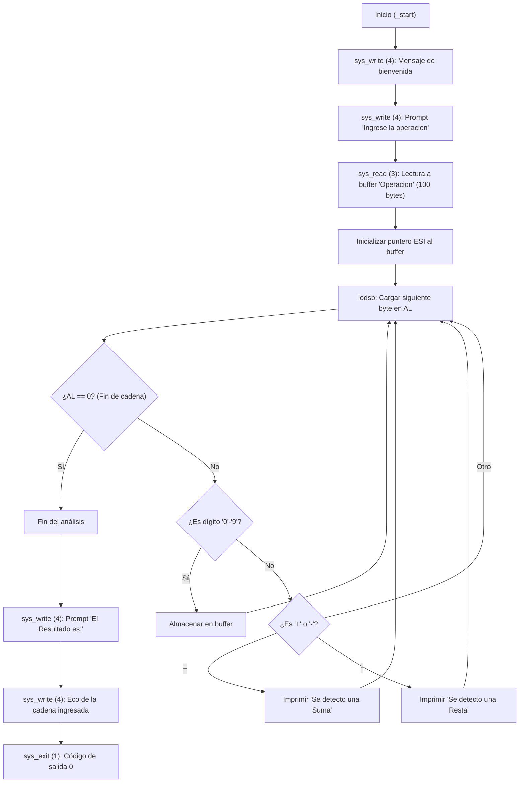

# Assembler Calculator (x86-32 PoC)

[](LICENSE)
[-blue.svg)](https://www.nasm.us/)
[-red.svg)]()
[]()

> **Nota histórica y alcance:** Este repositorio contiene un experimento educativo de bajo nivel desarrollado en diciembre de 2023. Su propósito fue explorar la programación en lenguaje ensamblador para arquitectura **x86 de 32 bits (IA-32)** en Linux utilizando llamadas directas al kernel (`int 0x80`).

---

## 📌 Estado Técnico del Proyecto

Originalmente concebido para resolver operaciones aritméticas básicas, el código actual en [src/Calculator.asm](file:///home/jr_g/Develop/Assembler-Calculator/src/Calculator.asm) funciona como una **prueba de concepto (PoC) de lectura de memoria y análisis elemental de caracteres en buffer**:

- ✅ **Flujo de E/S en terminal:** Presenta mensajes y captura la entrada del usuario mediante las llamadas al sistema `sys_read` y `sys_write`.
- ✅ **Escaneo de cadenas:** Recorre el buffer de entrada byte a byte usando la instrucción de procesador `lodsb`.
- ✅ **Detección de operadores:** Identifica la presencia de los caracteres `+` y `-` imprimiendo una notificación en pantalla.
- ⚠️ **Evaluación aritmética:** El código actual no realiza cálculo numérico (no convierte cadenas ASCII a valores numéricos enteros binarios ni ejecuta instrucciones `add`/`sub` aritméticas).

---

## 🏗️ Flujo de Ejecución (Arquitectura Interna)

El siguiente diagrama ilustra el flujo secuencial de ejecución del programa en la sección `.text`:



---

## 🚀 Compilación y Ejecución Rápida

### Prerrequisitos
Se requiere el ensamblador **NASM** y el enlazador **GNU `ld`** con soporte para emulación de 32 bits (`elf_i386`).

En distribuciones basadas en Ubuntu / Debian:
```bash
sudo apt update
sudo apt install -y nasm binutils gcc-multilib
```

### Comandos de Construcción
```bash
# 1. Ensamblar a código objeto ELF de 32 bits
nasm -f elf32 src/Calculator.asm -o src/Calculator.o

# 2. Enlazar el binario ejecutable para arquitectura x86-32
ld -m elf_i386 src/Calculator.o -o src/Calculator

# 3. Ejecutar
./src/Calculator
```

---

## 📂 Estructura del Repositorio

```text
.
├── .devcontainer/
│   └── devcontainer.json               # Configuración para entorno reproducible Docker
├── docs/
│   ├── assembly-guide.md               # Fundamentos de Assembly x86, registros y syscalls
│   └── troubleshooting-and-toolchain.md # Guía de compilación, flags y resolución de errores
├── src/
│   └── Calculator.asm                  # Código fuente original en NASM (Intel syntax)
├── LICENSE                             # Licencia MIT
└── README.md                           # Documentación principal del proyecto
```

---

## 📚 Documentación Técnica Detallada

Para comprender a fondo la arquitectura y el funcionamiento del código a bajo nivel, consulta las guías dedicadas en la carpeta `docs/`:

1. [**Guía de Fundamentos de Ensamblador x86**](file:///home/jr_g/Develop/Assembler-Calculator/docs/assembly-guide.md):
   - Explicación de registros (`EAX`, `EBX`, `ECX`, `EDX`, `ESI`, `EDI`, etc.).
   - Secciones de memoria (`.data`, `.text`, Stack).
   - Tabla de interrupciones y llamadas al sistema Linux (`int 0x80`).
   - Diferencias de sintaxis Intel vs AT&T y análisis detallado de instrucciones.
2. [**Guía de Toolchain y Troubleshooting**](file:///home/jr_g/Develop/Assembler-Calculator/docs/troubleshooting-and-toolchain.md):
   - Instalación paso a paso en múltiples distribuciones Linux.
   - Resolución de errores de emulación (`elf_i386`) y bibliotecas de 32 bits en sistemas modernos x86_64.
   - Uso de Dev Containers.

---

## 📜 Licencia

Este proyecto está distribuido bajo la licencia **MIT**. Para más detalles, consulta el archivo [LICENSE](file:///home/jr_g/Develop/Assembler-Calculator/LICENSE).
